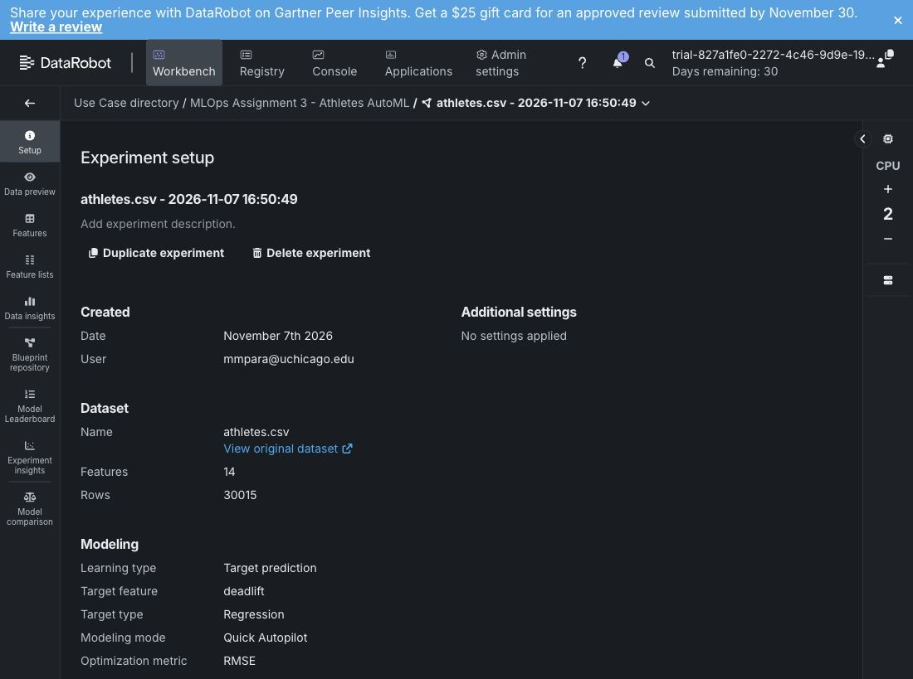
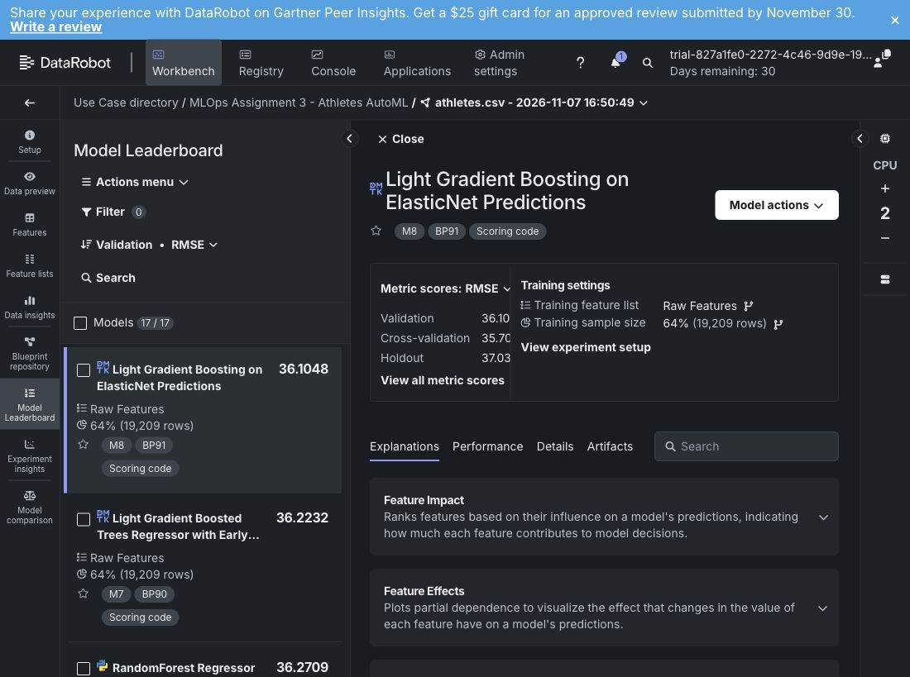
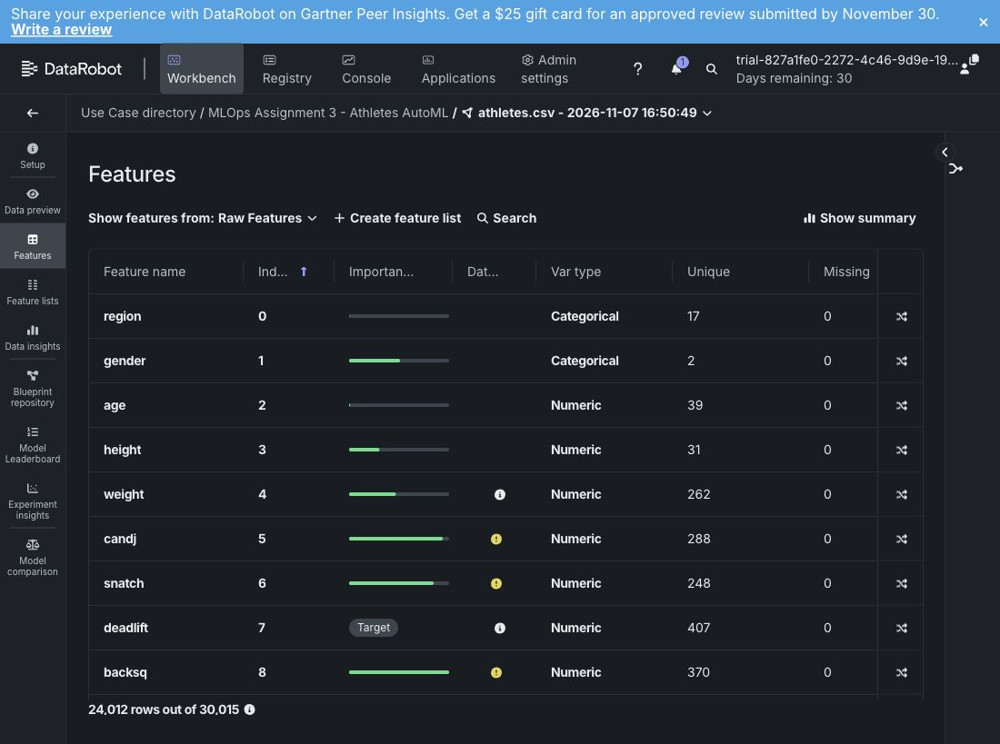
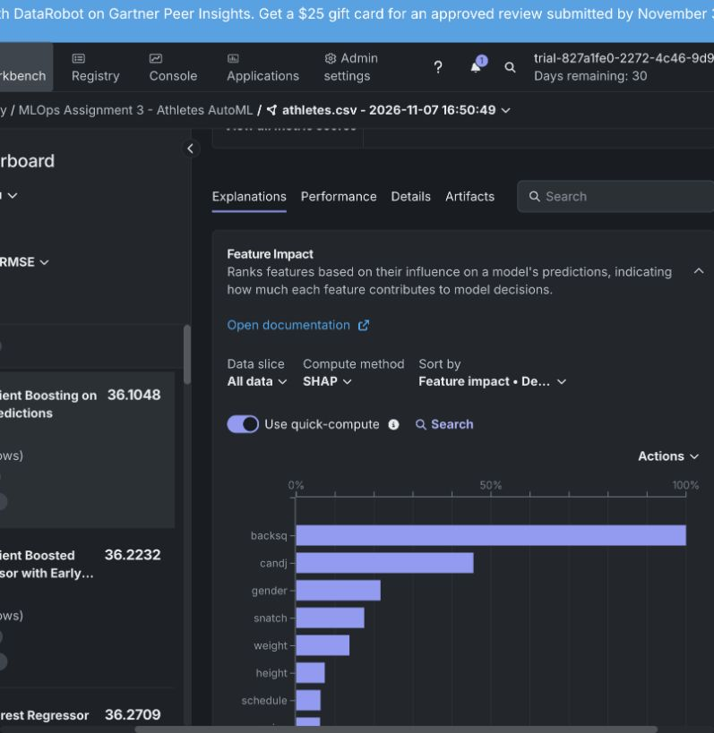
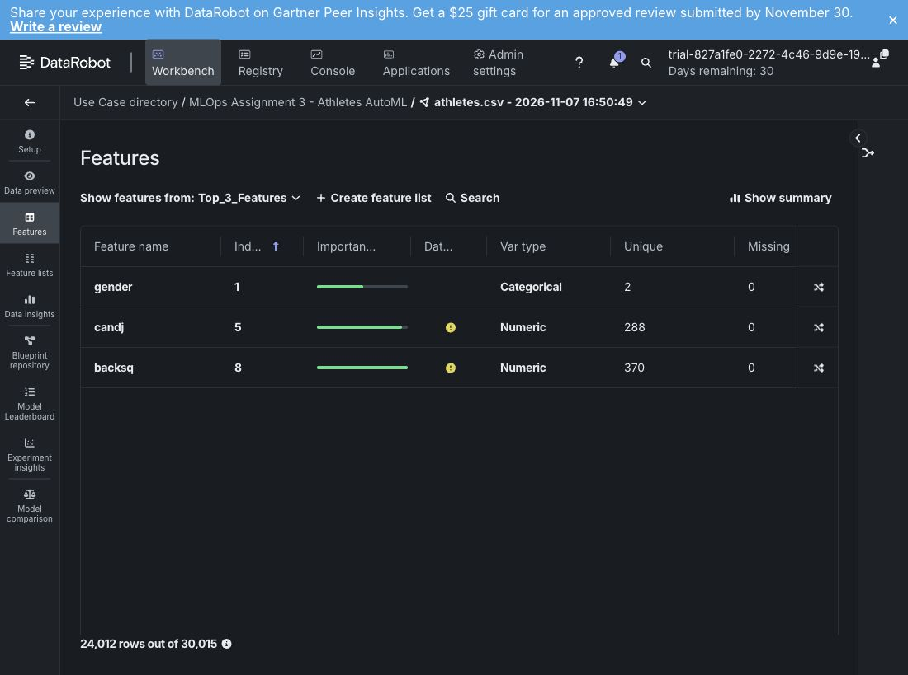
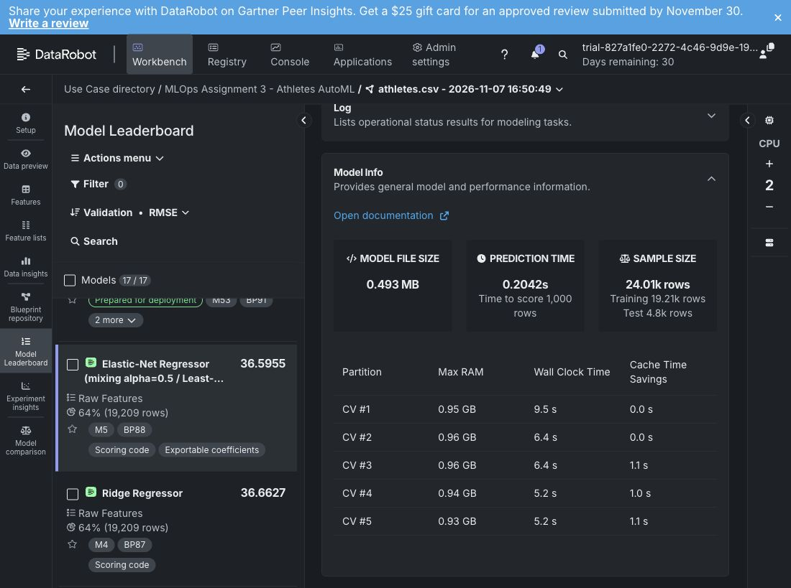
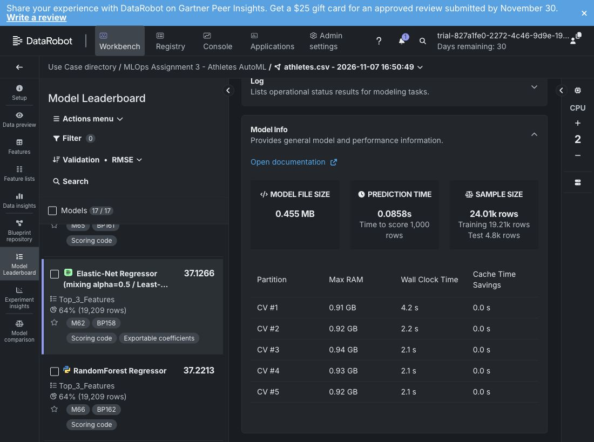
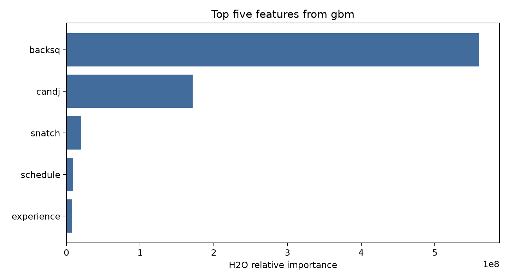

# Assignment 3 AutoML

Dataset: **athletes.csv** · Target: **deadlift** · Metric: **RMSE** (lower is better).

## DataRobot

### 1 Dataset

Uploaded 30,015 rows with 13 predictors and one target. Quick Autopilot used five-fold cross-validation and a 20% holdout. The original models used 19,209 training rows.



### 2 Best AutoML model

**M8 — Light Gradient Boosting on ElasticNet Predictions**.

| Validation RMSE | Cross-validation RMSE | Holdout RMSE |
|---|---|---|
| 36.1048 | 35.7005 | 37.0318 |



### 3 Data insights

- No missing values in the 24,012-row non-holdout summary.
- Deadlift: mean **361.89**, median **375**, range **1–1000**.
- Weight values as low as **5** and lift values of **1** merit review; no records were changed.



### 4 Top five features

M8 SHAP Feature Impact ranks **backsq, candj, gender, snatch, weight**, in that order.

The three-feature models use **backsq, candj, gender**.





### 5 Top three models by validation score

**All features**

| Rank | Model | Model name | Validation RMSE |
|---|---|---|---|
| 1 | M8 | Light Gradient Boosting on ElasticNet Predictions | 36.1048 |
| 2 | M7 | Light Gradient Boosted Trees Regressor with Early Stopping | 36.2232 |
| 3 | M9 | RandomForest Regressor | 36.2709 |

**Top three features**

| Rank | Model | Model name | Validation RMSE |
|---|---|---|---|
| 1 | M64 | Light Gradient Boosted Trees Regressor with Early Stopping | 36.7092 |
| 2 | M67 | RuleFit Regressor | 36.8349 |
| 3 | M63 | Generalized Additive2 Model | 36.8518 |

### 6 Top three models by speed

Speed = mean of five CV **Wall Clock Time** values under Model Info. Lower is faster; this measures training time, not prediction time.

**All features**

| Rank | Model | Model name | Mean seconds |
|---|---|---|---|
| 1 | M5 | Elastic-Net Regressor (mixing alpha=0.5 / Least-Squares Loss) | 6.54 |
| 2 | M4 | Ridge Regressor | 8.84 |
| 3 | M11 | eXtreme Gradient Boosted Trees Regressor with Early Stopping | 9.00 |



**Top three features**

| Rank | Model | Model name | Mean seconds |
|---|---|---|---|
| 1 | M62 | Elastic-Net Regressor (mixing alpha=0.5 / Least-Squares Loss) | 2.54 |
| 2 | M61 | Ridge Regressor | 3.36 |
| 3 | M65 | Light Gradient Boosting on ElasticNet Predictions | 3.62 |



M53 is excluded from the speed ranking because it has no five-fold timing data. Full scores and fold times: [results.csv](results.csv).

### 7 Comparison with Assignment 1 Part A

DataRobot’s best model had a validation RMSE of 36.10, while Part A had a test RMSE of 131.53. However, Part A predicted total lift and DataRobot predicted deadlift, so the scores aren’t directly comparable. 

Part A trained in about 3 seconds versus 10.16 seconds per CV fold for DataRobot M8, but the hardware and timing methods differed.

### 8 Platform classification

**No-code:**  I used DataRobot to upload data, train models, and compare results without writing code as a way to explore what we discussed during lecture.

## H2O AutoML

### 2 Best AutoML model

**StackedEnsemble AllModels** is the best model with all features: validation RMSE **37.2183**, test RMSE **35.5588**.

Each feature set evaluated **12 models** using five-fold CV. Both used the same **19,294 training**, **4,807 validation**, and **5,914 test** rows (seed 42). Validation RMSE ranked models; test data were evaluated after selection. The search included GLM, GBM, DRF, and stacked ensembles, with a limit of 10 base models plus ensembles.

### 3 Data insights

- **0 missing cells** and **1 exact duplicate row**; no records were removed.
- Deadlift: mean **362.10**, median **375**, range **1–1000**.
- **backsq** has the strongest numeric correlation with deadlift (**0.904**).
- Using only three features increases the best validation RMSE from **37.2183** to **38.3772**.

### 4 Top five features

**backsq, candj, snatch, schedule, experience**, in descending order.

These are native variable importances from **GBM_5**, the best-ranked model supporting importance—not the stacked ensemble. The reduced search uses **backsq, candj, snatch**.



### 5 Top three models by validation score

**All features**

| Rank | Model | Validation RMSE |
| --- | --- | --- |
| 1 | StackedEnsemble_AllModels_1 | 37.2183 |
| 2 | StackedEnsemble_BestOfFamily_1 | 37.2364 |
| 3 | GBM_5 | 37.5075 |

**Top three features**

| Rank | Model | Validation RMSE |
| --- | --- | --- |
| 1 | StackedEnsemble_AllModels_1 | 38.3772 |
| 2 | StackedEnsemble_BestOfFamily_1 | 38.3962 |
| 3 | GBM_grid_1_model_1 | 38.4628 |

Model names above omit run timestamp suffixes. Full model IDs: [all-feature leaderboard](h2o_results/all_features_leaderboard.csv) and [three-feature leaderboard](h2o_results/top3_features_leaderboard.csv).

H2O and DataRobot use different partitions and preprocessing, so their scores are not a controlled comparison. DataRobot's data summary uses non-holdout rows; H2O's summary uses the entire uploaded dataset.

## Working code

- [H2O Python code](h2o_automl.py)
- [Dependencies](requirements_h2o.txt)
- [Setup instructions](README_H2O.md)
- [Run metadata](h2o_results/run_metadata.json)

Run in the existing environment:

```sh
./run_h2o.sh
```

# mlops_assignment3
